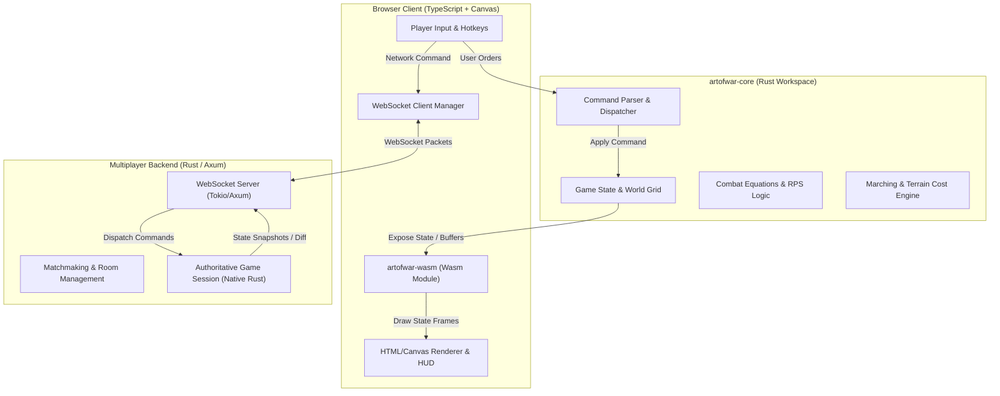

# The Ancient Art of War: WebAssembly & Multiplayer Implementation Plan

This document outlines the end-to-end architectural plan to evolve the current single-player TypeScript prototype into a **dual-target engine**:
1. **Local Mode**: Runs client-side via **WebAssembly (Rust)** for instant zero-latency offline play with zero server infrastructure costs.
2. **Online Multiplayer Mode**: Re-uses the **exact same Rust engine** on an authoritative WebSocket game server (or lockstep relay) to power real-time PvP matches.

---

## 1. System Architecture & Component Diagram



---

## 2. Phased Implementation Roadmap

### Phase 1: Architecture Refactoring & Command Pattern (TypeScript)
**Objective**: Prepare the current codebase for backend/Wasm abstraction without breaking the working game.

- [ ] **1.1 Command Decoupling**:
  - Replace direct state mutations in [`src/main.ts`](file:///Users/nh/Documents/repos/personal/artofwar/src/main.ts) with formal `Command` objects:
    ```typescript
    type GameCommand =
      | { type: 'MARCH_SQUAD'; squadId: string; targetX: number; targetY: number }
      | { type: 'SET_TACTICAL_STANCE'; squadId: string; unitTypes: UnitType[]; stance: Stance }
      | { type: 'RESTART_GAME' };
    ```
  - Route all player clicks and AI decisions through a single `dispatchCommand(cmd: GameCommand)` function.
- [ ] **1.2 Render Loop Isolation**:
  - Ensure the render functions (`renderStrategic()`, `renderTactical()`) are purely read-only and depend only on an immutable snapshot of `GameState`.

---

### Phase 2: Core Simulation in Rust (`crates/core`)
**Objective**: Build a deterministic, platform-agnostic strategy simulation crate.

- [ ] **2.1 Initialize Rust Cargo Workspace**:
  - Create workspace directory structure:
    - `crates/core`: Pure Rust game logic (no OS or browser dependencies, `no_std` compatible if needed).
    - `crates/wasm`: `wasm-bindgen` bindings and JS glue.
    - `crates/server`: Native server executable (Axum + Tokio).
- [ ] **2.2 Port Core Game Models**:
  - Grid terrain ($16 \times 12$), squads, conditions, unit cohorts (Knights, Archers, Barbarians).
  - Combat damage formula ($2.0\times$ advantage multipliers, condition scaling).
  - Arrow trajectory physics and collision detection.
- [ ] **2.3 Deterministic Game Loop**:
  - Implement fixed timestep updates (`tick(dt)`).
  - Standardize numeric math to ensure cross-platform parity between WebAssembly (client) and x86/ARM (server).

---

### Phase 3: WebAssembly Integration & Offline Play
**Objective**: Replace the TypeScript game engine with WebAssembly while preserving the existing Canvas UI.

- [ ] **3.1 Build Wasm Bridge (`crates/wasm`)**:
  - Expose lifecycle functions via `wasm-bindgen`:
    - `init_game(seed: u64) -> WasmGameInstance`
    - `dispatch_command(cmd_json_or_binary)`
    - `tick(dt: f32)`
    - `get_render_state() -> TypedArray / MemoryPointer`
- [ ] **3.2 Memory & Performance Optimization**:
  - Leverage direct WebAssembly memory buffers (`Float32Array` / `Uint8Array`) for entity positions and HP to avoid per-frame JSON serialization overhead.
- [ ] **3.3 Vite Build Integration**:
  - Configure `vite-plugin-wasm` or `wasm-pack` build script to output directly into the frontend assets.
  - Test complete local solo gameplay against the Rust-driven Sun Tzu AI.

---

### Phase 4: Multiplayer Server & Protocol
**Objective**: Build a lightweight, scalable backend using the native `crates/core`.

- [ ] **4.1 Network Protocol Specification**:
  - Lightweight binary (MessagePack / Bincode) or compressed JSON over WebSockets:
    - Client Messages: `JoinRoom`, `PlayerInput { tick, command }`, `Heartbeat`.
    - Server Messages: `RoomJoined { player_id, role }`, `GameStart`, `SyncTick { tick, commands }`, `GameOver`.
- [ ] **4.2 Server Implementation (`crates/server`)**:
  - Built with **Tokio** and **Axum WebSockets**.
  - **Lobby Manager**: Quick-match 1v1 queue and invite code support.
  - **Room Runner**: Ticks authoritative instances of `artofwar-core` at 20–30 Hz.
- [ ] **4.3 Verification of Anti-Cheat & Authority**:
  - Server validates command legality (e.g. squads can only be commanded by their owner, cooldown checks).

---

### Phase 5: Online Multiplayer UI & Client State Sync
**Objective**: Add lobby management and seamless multiplayer flow to the web client.

- [ ] **5.1 Multiplayer UI Overlays**:
  - Mode selector on the main screen: **Single Player (Local Wasm)** vs. **Online 1v1**.
  - Room code generator and matchmaking waiting screen.
- [ ] **5.2 Client Network Controller**:
  - Seamlessly swap the command pipeline:
    - *Local mode*: `Command` $\rightarrow$ `Local Wasm Engine`.
    - *Online mode*: `Command` $\rightarrow$ `WebSocket Server` $\rightarrow$ `Client Render Buffer`.
- [ ] **5.3 Client Interpolation & Latency Compensation**:
  - Linear interpolation (lerp) between incoming server tick updates to maintain smooth 60 FPS Canvas animations even under jittery network conditions.

---

## 3. Technology Stack & Directory Structure

```
artofwar/
├── Cargo.toml                    # Cargo workspace definition
├── crates/
│   ├── core/                     # Pure game logic (Rust)
│   │   ├── Cargo.toml
│   │   └── src/
│   │       ├── state.rs          # Entities, grid, combat stats
│   │       ├── terrain.rs        # Map tiles and movement cost
│   │       ├── simulation.rs     # Tick logic, damage calculation
│   │       └── commands.rs       # Serializable game commands
│   ├── wasm/                     # WebAssembly bindings (wasm-bindgen)
│   │   ├── Cargo.toml
│   │   └── src/lib.rs
│   └── server/                   # Native multiplayer server (Axum/Tokio)
│       ├── Cargo.toml
│       └── src/
│           ├── main.rs
│           ├── lobby.rs          # Room pairing and lifecycle
│           └── session.rs        # Authoritative tick runner
├── src/                          # Browser Frontend (Current)
│   ├── main.ts                   # UI coordination, canvas setup
│   ├── style.css                 # Dark parchment aesthetic
│   ├── net/                      # WebSocket manager & protocol handlers
│   └── wasm/                     # Generated wasm bindings
├── index.html
├── vite.config.ts
└── package.json
```

---

## 4. Key Architectural Decisions & Tradeoffs

| Decision | Selected Approach | Rationale |
| :--- | :--- | :--- |
| **Multiplayer Sync Model** | **Server-Authoritative with Snapshot Deltas** | Prevents fog-of-war map hacks and eliminates desync recovery nightmares associated with pure P2P lockstep. |
| **Serialization Format** | **JSON initially, MessagePack/CBOR for production** | JSON allows rapid debugging in browser DevTools network tab; binary packs can be toggled without rewriting command structures. |
| **Client Rendering** | **Canvas 2D (Retained)** | The existing canvas setup is performant for the $800 \times 600$ viewport and keeps asset overhead minimal. |

---

## 5. Verification & Testing Strategy

1. **Deterministic Unit Tests (`crates/core`)**:
   - Seeded battle simulations: Run 1,000 battles with identical inputs to guarantee exact output parity.
2. **Wasm Headless Tests**:
   - Run `wasm-pack test --headless --chrome` to ensure Wasm parity with native unit tests.
3. **Network Simulation Tests**:
   - Test room synchronization under simulated 150ms latency and 2% packet loss using mock WebSocket clients.
